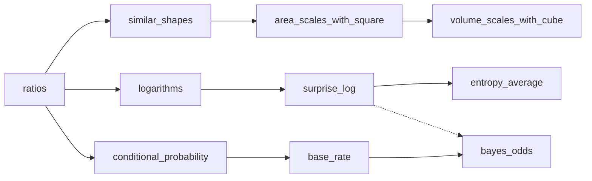

# Learning plan

<!-- teachable-figures workspace · schema v1 · SAMPLE for an adult self-learner (illustrative, not real data). -->

- **Domain / goal:** scaling, probability and information for reading data-science articles
- **Standards (optional):** none — self-directed

## Knowledge points

| id | point | prerequisites | objective | misconceptions | status | lessons |
| --- | --- | --- | --- | --- | --- | --- |
| ratios | Ratios and proportional scaling | | can scale quantities by a factor | | secure | |
| similar-shapes | Similar shapes share proportions | ratios | can say which lengths scale together | | introduced | cone-sections |
| area-scales-with-square | Area scales with the square of length | similar-shapes | can predict ×k² and explain why with tiles | linear-scaling | secure | cone-sections |
| volume-scales-with-cube | Volume scales with the cube | area-scales-with-square | can predict ×k³ for a scaled solid | linear-scaling | not-started | |
| logarithms | log₂ as "how many halvings" | ratios | can compute log₂ of powers of 2 and estimate others | | practising | |
| surprise-log | Surprise = log₂(1/p) | logarithms | can say why rare outcomes carry more bits | | introduced | entropy-questions |
| entropy-average | Entropy as average yes/no questions | surprise-log | can explain why bundling gets below 1 question per item | | practising | entropy-questions |
| conditional-probability | P(A\|B) vs P(B\|A) | ratios | can read and compute a conditional from a 2×2 count | inverse-conditional | practising | bayes-base-rate |
| base-rate | Base rates shape the posterior | conditional-probability | can predict the positive predictive value from a count | inverse-conditional | introduced | bayes-base-rate |
| bayes-odds | Bayes in odds form | base-rate | can update prior odds by a likelihood ratio | probability-times-lr | introduced | bayes-base-rate |

## Links beyond prerequisites

| from | relation | to | note |
| --- | --- | --- | --- |
| area-scales-with-square | same-mechanism | volume-scales-with-cube | squaring → cubing; good transfer target |
| surprise-log | applies-to | bayes-odds | log-odds as evidence in bits (later) |
| base-rate | contrasts-with | conditional-probability | the inverse confusion |

## Graph

## Next suggestions

- **volume-scales-with-cube**: prerequisite secure; transfer case for linear-scaling.
- **conditional-probability** (review): inverse-conditional is still active; try a 2×2 count figure with a new context, such as a spam filter.
- **entropy-average**: practising; one independent explanation of the ≥1 question limit would move it to secure.
